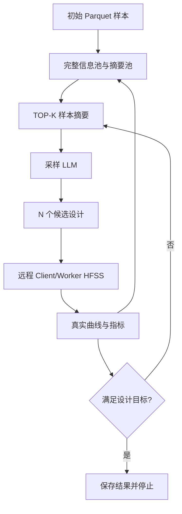

# LLMO 单 LLM 双频天线闭环优化

本项目使用一个采样设计智能体优化双频天线：智能体根据已有样本提出候选设计，并从真实仿真结果中继续寻找更好的变量组合。HFSS 是固定的物理仿真与评估环节，通过远程 ele_sim Client/Worker 运行；智能体负责优化决策，HFSS 返回候选的真实响应。项目不使用神经网络代理模型。

## 优化流程



每轮只把摘要池中按真实评分排序的 TOP-K 样本发送给采样 LLM。LLM 必须返回
`optimization.proposals_per_iteration` 个候选；候选随后全部提交远程 HFSS。
仿真完成后，代码计算谐振、目标频点 S11 和 ranking score，将候选及完整曲线
写入完整信息池并刷新摘要池，直到满足目标或达到最大迭代次数。

## 设计变量

`a`、`b`、`l1`、`l2`、`l3`、`s1`、`s2`、`s3`、`f_l` 的范围、单位和含义
全部从 `project.conf` 动态读取。LLM 提示词不会写死这些范围。

## LLM 候选契约

提示词位于 [prompts/sampling_guidance.md](prompts/sampling_guidance.md)，运行时动态填充：

- 目标频率、S11 阈值、变量范围和候选数量；
- 摘要池 TOP-K 的紧凑匿名样本行；
- 评分定义和代码控制的停止条件。

返回格式只有一个 JSON 对象：

```json
{
  "proposals": [
    {
      "variables": {
        "a": 125.00,
        "b": 60.00,
        "l1": 30.00,
        "l2": 10.00,
        "l3": 30.00,
        "s1": 1.00,
        "s2": 5.00,
        "s3": 0.90,
        "f_l": 10.00
      },
      "rationale": "one evidence-based paragraph"
    }
  ]
}
```

代码校验候选数量、变量完整性、范围和有限数值；越界值按现有随机修复策略处理，
重复候选会按配置扰动后继续提交。LLM 不得宣称候选已经满足停止条件，最终判断只由
真实 HFSS 结果和代码完成。

## 样本池与输出

运行目录包含：

- `complete_information_pool.json`：所有初始样本和已完成真实 HFSS 的候选，保存完整曲线、指标、远程任务元数据和候选 `rationale`。
- `sample_summary_pool.json`：按 score 降序保存的摘要池，容量由 `optimization.summary_pool_size` 控制，必须不小于 `top_k`。
- `candidate_proposals.json`：每轮原始候选、修复结果、重复扰动和理由的审计记录。
- `optimization_result.json`：成功或达到最大迭代次数时的最佳样本。
- `logs/run_*/run.log`：流程日志。
- `logs/run_*/llm_interactions.json`：采样请求、响应、重试和预检的顺序日志。

恢复运行时只恢复完整池和摘要池，并从最后一个已完成迭代继续。

## 配置与运行

### 密钥与远程连接

`project.conf` 不保存 API 密钥。默认采样模块的 `llm.sampling.api_key` 为空，程序通过 `llm.sampling.api_key_env` 指定的 `DEEPSEEK_API_KEY` 环境变量读取密钥。切换到其他服务商时，应同步修改 `provider`、`base_url`、`model_id` 和 `api_key_env`；示例变量名见 `.env.example`。远程 ele_sim 数据库连接串通过 `ELE_SIM_DATABASE_URL` 提供。运行前可在 PowerShell 中设置：

```powershell
$env:DEEPSEEK_API_KEY = "你的 API 密钥"
$env:ELE_SIM_DATABASE_URL = "你的数据库连接串"
```

`.env.example` 仅列出变量名；不要将真实密钥写入配置、运行日志或提交到仓库。

### 初始样本模式

`project.use_initial_parquet = true`（默认）会读取 `project.initial_parquet`，将其中的 40 条真实 HFSS 曲线重新计算指标并导入样本池；采样 LLM 继续使用原来的提示词模板。设置为 `false` 则完全跳过初始 Parquet，从空样本池开始，第一轮由采样 LLM 根据电磁知识和变量范围提出探索候选。此时提示词改用 `prompts/sampling_guidance_zero.md`，TOP-K 文本写入实际可用样本数；首轮为 0，随后最多取配置的 `optimization.top_k` 条。没有样本时不会声称有测量结果。

可临时覆盖配置：`python main.py --config project.conf --set project.use_initial_parquet=false`。两种模式请使用不同的新运行目录；零样本模式拒绝恢复包含初始 Parquet 样本的目录。`--validate-only` 在零样本模式下也不读取初始 Parquet。

`project.conf` 中与当前单 LLM 框架相关的主要配置：

- `optimization.top_k`、`optimization.proposals_per_iteration`、`optimization.max_iterations`；
- `llm.sampling.*`、`llm.max_connection_attempts`、`llm.preflight.*`；
- `remote.*` 控制 ele_sim 数据库、任务重试和等待；
- `antenna.*`、`score.*` 控制检测、目标和排序；
- `simulation.*` 保留本地测试/兼容模式，生产闭环使用远程 Client/Worker。

只校验配置和初始数据：

```powershell
python main.py --config project.conf --validate-only
```

启动新运行：

```powershell
python main.py --config project.conf
```

指定新目录或恢复已有目录：

```powershell
python main.py --config project.conf --output-dir experiment_a
python main.py --config project.conf --resume-dir experiment_a
```

命令行覆盖示例：

```powershell
python main.py --config project.conf \
  --set optimization.max_iterations=10 \
  --set optimization.top_k=6 \
  --set llm.sampling.provider="deepseek"
```

## 远程 HFSS

`client_submitter.py` 把本地九变量映射为远程任务字段并提交 ele_sim。
`plugins/worker_simulation.py` 在 Worker 端调用
`plugins/_lib/cpw_hfss_runner.py` 执行真实 HFSS，返回完整频率和 S11 向量。
远程任务成功后才会进入样本池；失败任务不会被当作设计证据。

## 测试与检查

```powershell
python -m compileall -q llmo main.py client_submitter.py plugins test_llm_endpoint.py
pytest
```

`test_llm_endpoint.py` 只检查 `llm.sampling` 端点和采样预检。
